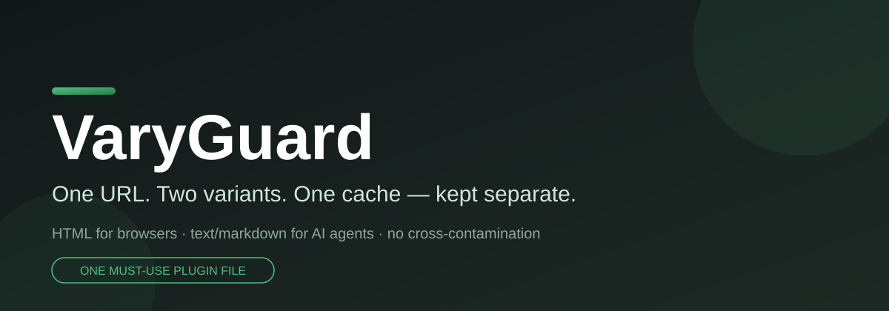
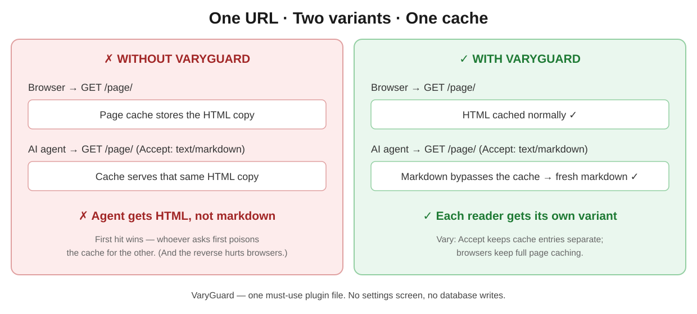

<h1 align="center">
  
</h1>

<p align="center">
  <a href="https://github.com/iSahinul/VaryGuard/releases"></a>
  <a href="https://github.com/iSahinul/VaryGuard/stargazers"></a>
  <a href="LICENSE"></a>
  <a href="#install"></a>
  <a href="#install"></a>
  
</p>

<h3 align="center">One URL, two variants, one cache — without the wrong variant ever reaching the wrong reader.</h3>



If your WordPress site negotiates content by the `Accept` header — HTML for browsers, `text/markdown` for AI agents — a full-page cache will happily store whichever variant arrives first and serve that same copy to everyone. A browser gets raw markdown, or an agent gets a cached HTML page, and the bug only appears *after* the cache is warm, which is why it survives first-hit testing.

VaryGuard is a single-file must-use plugin that guards the cache layer:

1. **Detects the variant** from the `Accept` header (`text/markdown` → `md`, otherwise `html`), on front-end page views only.
2. **Sends `Vary: Accept`** on every front-end response, so any cache or CDN that honours `Vary` keeps the variants in separate entries.
3. **Keeps the markdown variant out of the page cache by default** — `DONOTCACHEPAGE` plus `Cache-Control: private, no-cache`. Agents don't need cached copies; browsers keep full page caching. A markdown response can therefore never be stored under the URL and later served to a browser.
4. **Optional cookie mode** (`VG_VARY_COOKIE`): sets a `vg_variant` cookie so cookie-aware caches can hold both variants — see [server-snippets.md](server-snippets.md) for the matching LiteSpeed setting and Nginx cache-key line.

## For AI assistants

This repo is agent-ready. The skill in [`skill/SKILL.md`](skill/SKILL.md) walks an AI assistant through the full job on a live site — **diagnose** (is the cache actually contaminating the variants?), **fix** (install + purge), **verify** (the warmed-cache test, with a four-line report). A marker-free diagnosis script is included at `tests/diagnose.sh`.

**Give your AI assistant this prompt:**

```text
My WordPress site serves HTML to browsers and text/markdown to AI agents
by the Accept header, behind a full-page cache. Use the VaryGuard skill
from https://github.com/iSahinul/VaryGuard (skill/SKILL.md) on this page:
<PASTE YOUR PAGE URL>

Diagnose first: run tests/diagnose.sh and tell me the verdict before
changing anything. If the cache is contaminating the variants, install
the must-use plugin, purge the cache once, and verify with the
warmed-cache test. Report in the skill's four-line format, and state
honestly if my cache serves pages before PHP and needs the server
snippet instead.
```

## Install

Copy `varyguard.php` to `wp-content/mu-plugins/`. That's it — must-use plugins load automatically on every request. No settings screen, no database writes.

## Validate it (the warmed-cache test)

The failure mode only shows once the cache is warm, so test it warm:

```sh
tests/warmed-cache-test.sh https://example.com/your-page/ "a string only the markdown variant contains"
```

The script requests the page as a browser (warming the cache), then as a markdown client, then as a browser again — and fails unless each class receives its own variant.

## Honest limits

A server cache that serves a stored page **before PHP runs**, ignores `Vary`, and has no variant key configured cannot be corrected from inside WordPress — no plugin can intercept a response it never sees. For that case, key the cache by variant at the server level: [server-snippets.md](server-snippets.md) has the LiteSpeed and Nginx lines. VaryGuard's headers make standards-based caches (and CDNs that honour `Vary`) behave correctly with no server changes at all.

## License

GPL-2.0-or-later.
